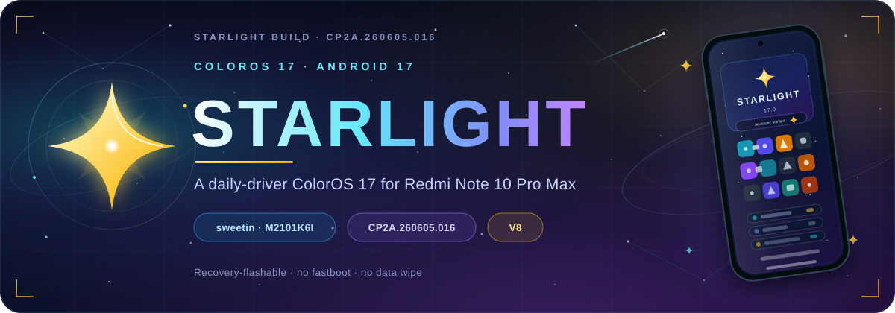
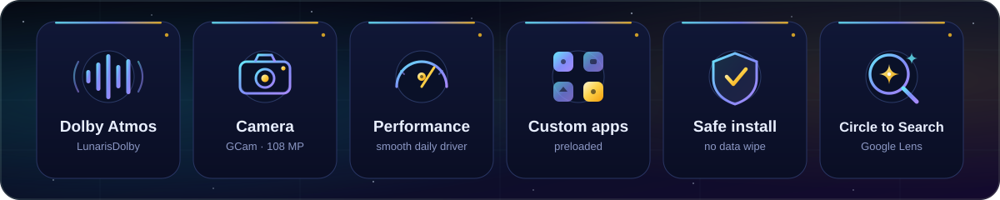
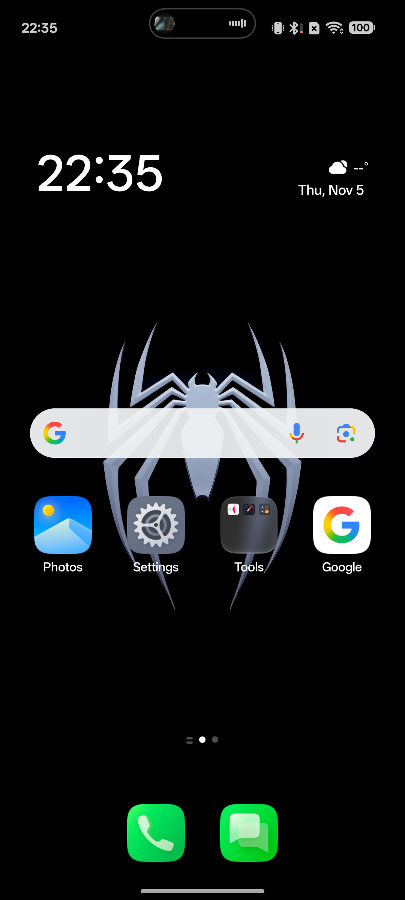
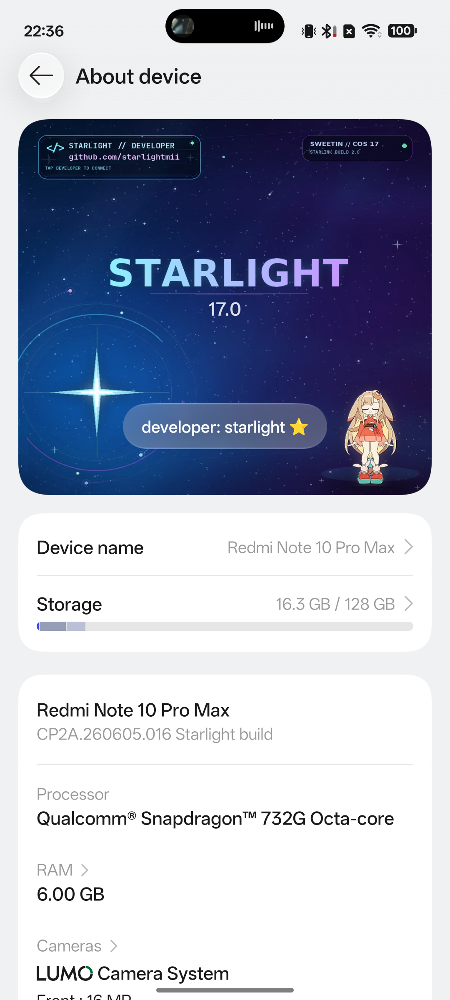
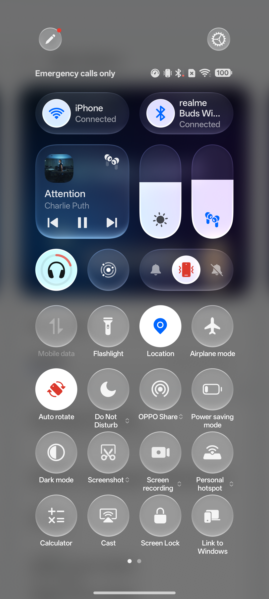
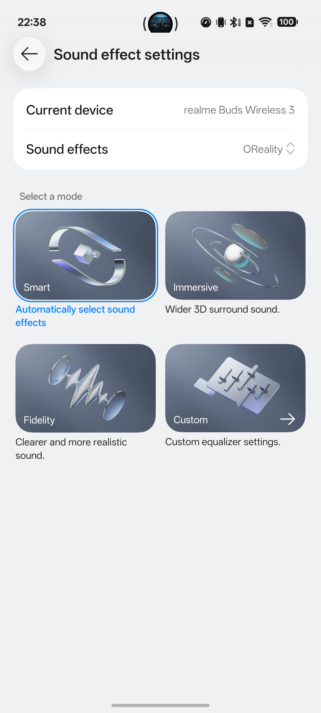
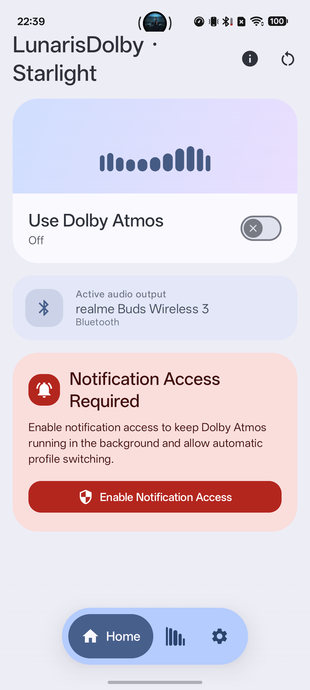
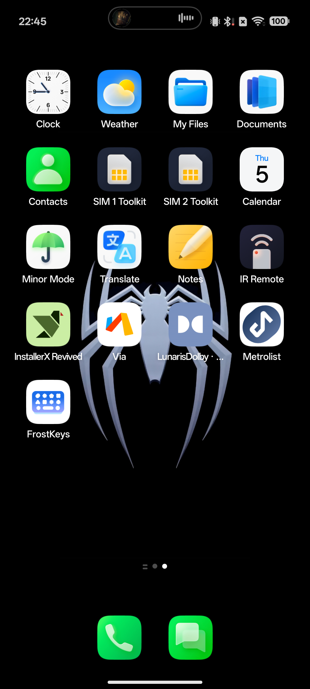
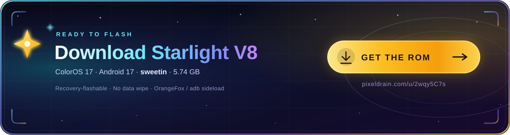
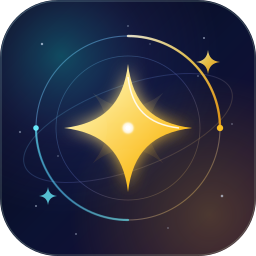

<div align="center">



<br/>

<h1>Starlight</h1>

<p><strong>ColorOS 17 (Android 17) for the Redmi Note 10 Pro Max</strong><br/>
<code>sweetin</code> · <code>M2101K6I</code> · Snapdragon 732G</p>

<p><em>An unofficial, recovery-flashable ColorOS 17 build for one specific phone.</em></p>

<a href="https://github.com/starlightmii"></a>
<a href="#download"></a>
<a href="#download"></a>
<a href="#download"></a>
<a href="#download"></a>
<a href="#download"></a>

</div>

---

## What is Starlight?

**Starlight** is an unofficial **ColorOS 17 (Android 17)** port for the
**Xiaomi Redmi Note 10 Pro Max** — codename **`sweetin`**, model **`M2101K6I`**,
Snapdragon 732G (SM7150).

It is a full system port, not a launcher pack or a theme. The ColorOS 17
system, vendor, product and custom partitions are built for `sweetin`, with
hardware the phone does not have removed, and the features it does have —
Dolby audio, the 108 MP camera stack and a custom app suite — kept and tuned.

The result is a **recovery-flashable daily driver** with a Starlight-branded
About page, a purposeful app suite, and **no data wipe**.

---

## At a glance

| | |
|---|---|
| **Device** | Redmi Note 10 Pro Max (`sweetin` / `M2101K6I`) |
| **Platform** | Snapdragon 732G (SM7150) |
| **Memory / storage** | 6 GB / 128 GB |
| **Region** | India · no NFC |
| **OS** | ColorOS 17 · Android 17 |
| **Build display** | `CP2A.260605.016 Starlight build` |
| **Package** | `ColorOS-17-Starlight-V8.zip` · 5.74 GB |
| **Install** | OrangeFox recovery · `adb sideload` |
| **Fastboot** | Not used, not required |
| **Data wipe** | Not required |
| **Status** | Daily-driver release |

---

## Highlights

<div align="center">

</div>

### Dolby Atmos, integrated

The Dolby Atmos stack is integrated as **LunarisDolby** and wired into
**Settings → Sound & vibration → Sound effect settings**. Dolby profiles and
sound modes are available in the LunarisDolby app, and the ColorOS
sound-effect page opens and works on-device.

### GCam camera

**GCam (Google Camera)** is the default capture app. The 108 MP camera stack
and sensor plumbing are kept intact, while the extra OPPO and Sogou camera
packages are removed from this build.

### A Starlight identity

The About page is fully customised:

- A Starlight banner with the star mark and `17.0` wordmark.
- A **`developer: starlight`** row that opens
  **[github.com/starlightmii](https://github.com/starlightmii)**.
- Device shown as **Redmi Note 10 Pro Max**.
- Build shown as **`CP2A.260605.016 Starlight build`**.

### Lean, relevant Settings

- **System updates** entries are removed — no dead update pages.
- **Screen-off gestures** are removed — no unsupported hardware toggles.
- Unsupported hardware entries for this device are trimmed from Settings and
  config, so the pages that remain are the ones that matter.

### Performance tuned for this phone

The build is tuned for the 6 GB / 128 GB `sweetin` configuration: a smoother
launcher and scrolling, lighter background work, and the native
**1080 × 2400** display kept at its native resolution — no forced
high-resolution mode.

### Circle to Search, wired in

The Google / Velvet assist path is wired for **Circle to Search** on the
navigation handle, alongside Google basic services.

### A custom app suite

A purpose-built custom partition (`cust.img`) ships a curated set of preloaded
apps:

**Notes · Weather · Translate · Documents · IR Remote · Screen sharing ·
Screencast · PersonalityClocks · Widgets · Motion wallpaper** — and more.

These are preloaded, not bolted on after first boot.

### Safe by design

- Recovery-only package — **no fastboot**.
- **No data wipe**; `/data` is left alone.
- Writes the standard partition set: `super.img.zst`, `cust.img.zst`,
  `boot.img`, `dtbo.img`, `vbmeta.img` and `vbmeta_system.img`.
- First boot can take several minutes while the system settles.

---

## Screenshots

<div align="center">

| Home | About — Starlight build |
|---|---|
|  |  |

| Quick Settings | Sound effects |
|---|---|
|  |  |

| LunarisDolby — Starlight | App drawer — custom apps |
|---|---|
|  |  |

</div>

Captured on-device at 1080 × 2400 from build
`CP2A.260605.016 Starlight build`.

---

## Demo

<div align="center">

https://github.com/user-attachments/assets/be5c47da-f533-4819-89d8-cada219a115d

<sub><strong>▶ 22-second walkthrough</strong> · MP4 · H.264/AAC · 720 × 1600 · 2.1 MB · [download](assets/screen-recording/starlight-demo.mp4) · [poster](assets/screen-recording/poster.png)</sub>

</div>

A quick pass through the Starlight app drawer, Settings and the Starlight
**About device** page on the release build. The player streams the committed
2.1 MB MP4 inline; the poster frame at 0:09 is kept as a fallback if the player
cannot load.

---

<a id="download"></a>
## Download

<div align="center">

[](https://pixeldrain.com/u/2wqy5C7s)

<sub><strong>Tap the card to open the download on pixeldrain</strong></sub>

</div>

### [Download `ColorOS-17-Starlight-V8.zip` — pixeldrain](https://pixeldrain.com/u/2wqy5C7s)

**[https://pixeldrain.com/u/2wqy5C7s](https://pixeldrain.com/u/2wqy5C7s)**

| | |
|---|---|
| **Primary host** | **[pixeldrain.com/u/2wqy5C7s](https://pixeldrain.com/u/2wqy5C7s)** |
| **Mirror / profile** | **[github.com/starlightmii](https://github.com/starlightmii)** |
| **File** | `ColorOS-17-Starlight-V8.zip` |
| **Size** | 5,746,312,130 bytes (5.74 GB) |
| **SHA-256** | `e7529ced36b59bea25ef0ba80a295d5c4c9c20a328ce8e4a44358b1e0b67392a` |

The ROM is hosted on **pixeldrain**. The
**[github.com/starlightmii](https://github.com/starlightmii)** profile carries
release announcements and mirrors.

> The 5.74 GB ZIP is **not** stored in this repository. Only this page, the
> media assets and the checksums live here.

### Verify before flashing

```bash
sha256sum ColorOS-17-Starlight-V8.zip
# e7529ced36b59bea25ef0ba80a295d5c4c9c20a328ce8e4a44358b1e0b67392a
```

The release assets — the SVGs, screenshots, poster and demo video — are
covered by [`CHECKSUMS.sha256`](CHECKSUMS.sha256). Run this from the
repository root:

```bash
sha256sum --ignore-missing -c CHECKSUMS.sha256
```

The ROM ZIP line is included as a reference. `--ignore-missing` lets the
command skip the ZIP when it is not in the repository.

---

<a id="install"></a>
## Install

### Requirements

- Redmi Note 10 Pro Max (`sweetin` / `M2101K6I`)
- Unlocked bootloader
- **OrangeFox Recovery** (or another recovery with `adb sideload` support)
- `adb` platform tools on your PC — **only `adb` is used**
- A full backup of anything you care about

### Flash with adb sideload

```bash
# 1. Boot the phone into OrangeFox recovery.
#    (Recovery → Reboot → Recovery, or the usual key combo.)

# 2. Confirm the PC sees the device in recovery.
adb devices

# 3. Sideload the complete ROM package.
adb sideload ColorOS-17-Starlight-V8.zip

# 4. Reboot to system.
#    First boot can take several minutes while the system settles.
```

### Flash from the phone (no PC)

1. Copy `ColorOS-17-Starlight-V8.zip` to internal storage or an SD card.
2. Boot into OrangeFox.
3. **Install → select the ZIP → swipe to flash.**
4. Reboot to system.

### What the package writes

| Partition image | Purpose |
|---|---|
| `super.img.zst` | ColorOS 17 system, product, system_ext and vendor |
| `cust.img.zst` | Custom app suite |
| `boot.img` | Boot image |
| `dtbo.img` | Device tree overlay |
| `vbmeta.img` | Verified boot metadata |
| `vbmeta_system.img` | System verified boot metadata |

### Rules

- **Do not use fastboot.** This is a recovery / sideload package.
- **Do not wipe `/data`.** The package is designed to keep your data.
- **Do not format internal storage.**
- Keep the ZIP on the device or PC until first boot succeeds.
- Verify the SHA-256 above before flashing.

---

## Verified on-device

- [x] Build display: `CP2A.260605.016 Starlight build`
- [x] Device identity: Redmi Note 10 Pro Max (`M2101K6I`, `sweetin`)
- [x] Dolby / LunarisDolby stack present and openable
- [x] Sound-effect settings page works
- [x] Starlight About banner and GitHub button
- [x] System updates and screen-off gesture entries removed
- [x] Custom app suite preloaded
- [x] Circle-to-Search plumbing
- [x] Recovery / sideload package layout (`super`, `cust`, `boot`, `dtbo`,
      `vbmeta`, `vbmeta_system`)

---

## Credits

| | |
|---|---|
| **Starlight** | Port, branding, integration, tuning and the custom app suite |
| **ColorOS 17** | Base system and framework |
| **LunarisDolby** | Dolby Atmos app and audio integration |
| **Google Camera (GCam)** | Default camera experience |
| **Kernel** | @maxmaxim59 — kernel build & port for sweetin |
| **OrangeFox Recovery** | Recovery and sideload workflow |
| **Testers** | Everyone who flashed, tested and reported back |

Starlight is an independent, unofficial project. It is **not affiliated with,
endorsed by, or supported by** OPPO, Xiaomi, Google or the LunarisDolby
maintainers. All trademarks belong to their respective owners.

---

## Disclaimer

Flash at your own risk. This is a community port built for one specific device
(`sweetin` / `M2101K6I`). Do not flash it on any other phone. Back up your
data, verify the checksum and keep a working recovery. The authors are not
responsible for bricked devices, lost data or voided warranties.

---

<div align="center">



<br/>

**Starlight — light years ahead of stock.**

[GitHub](https://github.com/starlightmii) · [Download](#download) · [Install](#install) · [Repository](https://github.com/Starlightmii/starlight-ports)

</div>
