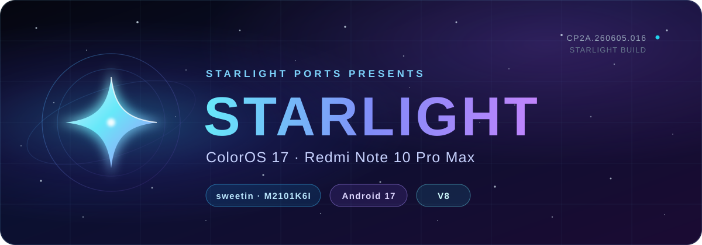
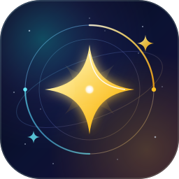
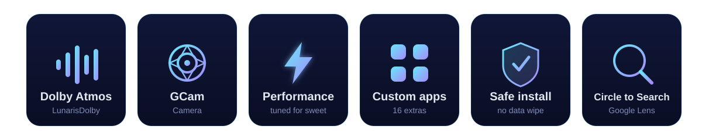
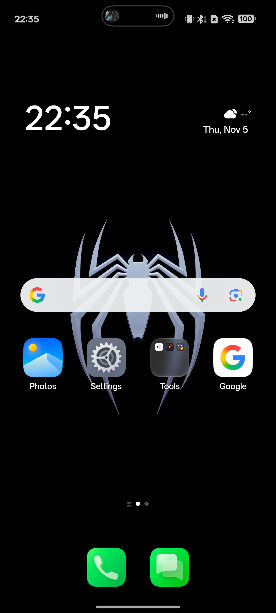
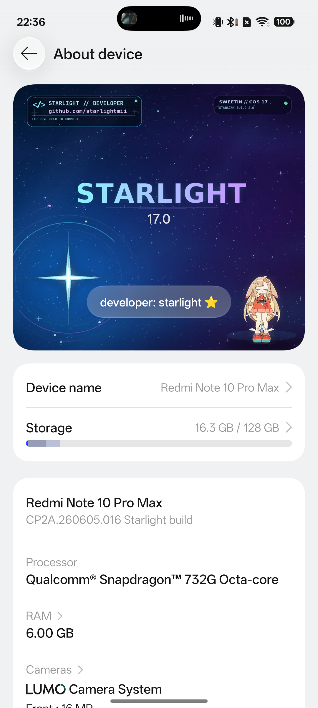
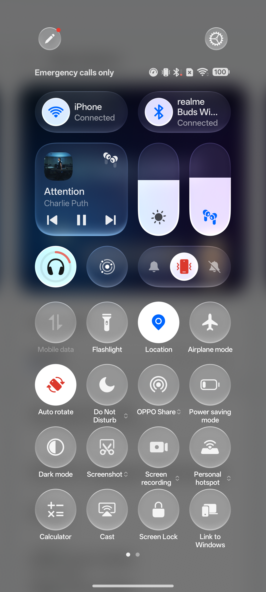
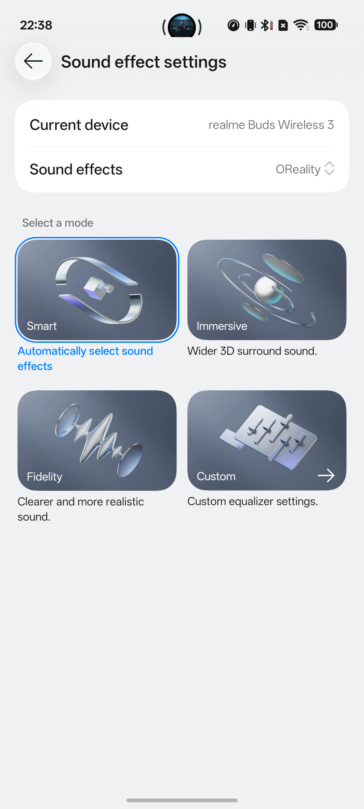
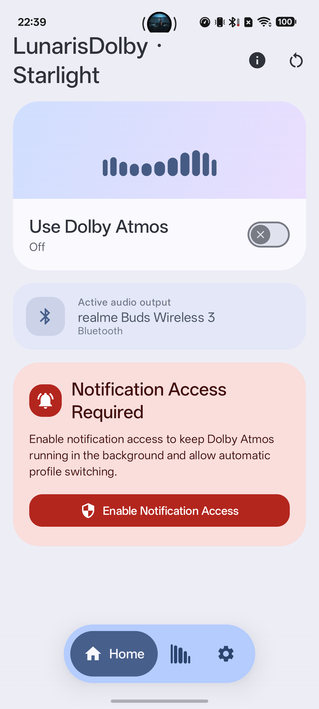
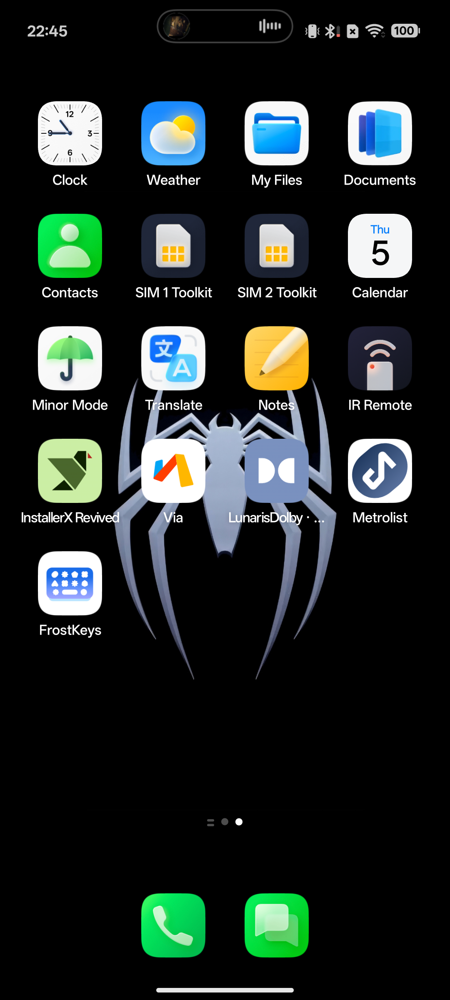
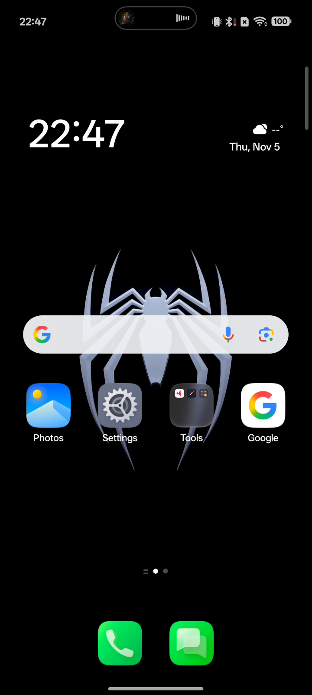

<div align="center">



<br/>

<h1>Starlight — ColorOS 17 for Redmi Note 10 Pro Max (sweetin)</h1>

<p><strong>A clean, daily-driver ColorOS 17 port for <code>sweetin</code> — built by Starlight.</strong></p>

<a href="https://github.com/starlightmii"></a>
<a href="#"></a>
<a href="#"></a>
<a href="#"></a>
<a href="#"></a>
<a href="#"></a>

<br/><br/>



</div>

---

## ✨ What is this?

**Starlight** is an unofficial **ColorOS 17 (Android 17)** port for the
**Xiaomi Redmi Note 10 Pro Max** — codename **`sweetin`**, model **`M2101K6I`**,
Snapdragon 732G (SM7150).

It is not a skin or a launcher pack. The full ColorOS 17 system, vendor, product
and custom partitions were rebuilt for `sweetin`, with the hardware that this
phone does not have removed, and the features it *does* have — Dolby, the 108 MP
camera stack, fast charging, IR blaster — kept and tuned.

The result is a **safe, recovery-flashable daily driver** with a custom app suite,
a Starlight-branded About page, and no data wipe.

<div align="center">

</div>

---

## 📱 At a glance

| | |
|---|---|
| **Device** | Redmi Note 10 Pro Max (`sweetin` / `M2101K6I`) |
| **Platform** | Snapdragon 732G — SM7150 |
| **OS** | ColorOS 17 · Android 17 |
| **Build display** | `CP2A.260605.016 Starlight build` |
| **Release** | `ColorOS-17-Starlight-V8.zip` — **5.74 GB** |
| **Install** | OrangeFox recovery · `adb sideload` |
| **Fastboot** | ❌ Not used, not required |
| **Data wipe** | ❌ Not required |
| **Status** | ✅ Daily-driver release |

---

## 🚀 Features

### 🔊 Dolby Atmos that actually works

**LunarisDolby v2** is integrated into the system and branded for Starlight.
The Dolby stack is live in **Settings → Sound & vibration → Sound effect
settings**, and in the **LunarisDolby** app, with the hardware audio path of
`sweetin` enabled instead of a generic software fallback.

- Dolby Atmos profiles and equaliser
- Quick Settings access
- Starlight branding, no third-party developer branding
- Sound effects page confirmed working on-device

### 📷 Camera

- **GCam (Google Camera)** is the default capture app.
- The **Sogou camera** and **OPPO camera** packages are removed.
- Camera extensions and sensor plumbing are kept intact for the 108 MP stack.

### ⭐ Starlight identity

The About page is fully customised:

- Starlight hero banner with the star mark and `17.0` wordmark
- **`developer: starlight ⭐`** row that opens
  **[github.com/starlightmii](https://github.com/starlightmii)**
- Device shown as **Redmi Note 10 Pro Max**
- Build shown as **`CP2A.260605.016 Starlight build`**

### 🧹 Lean system settings

- **System updates removed** — no dead OPPO/OnePlus update entries.
- **Screen-off gestures removed** — no unsupported hardware toggles.
- NFC, 5G/NR, alert-slider, UWB and other `sweetin`-absent hardware entries are
  stripped from the UI and config.
- 32-bit app support restored, so older apps keep working.

### ⚡ Performance tuned

The build is tuned for the 6 GB / 128 GB `sweetin` configuration: smoother
launcher and scrolling, trimmed background weight, and a display configuration
that keeps the native **1080 × 2400** resolution at **440 dpi** — no forced
high-resolution mode.

### 🔎 Circle to Search

The Google / Velvet assist plumbing is wired so **Circle to Search** resolves
correctly on long-press of the navigation handle. Google basic services and the
Play Store work on this CN-based donor port.

### 📦 Custom app suite (`cust.img`)

A purpose-built **`cust.img`** ships **16 preloaded apps**, including:

| App | App | App |
|---|---|---|
| Documents | Translate | Weather |
| IR Remote | Screen sharing | Motion wallpaper |
| Screencast | PersonalityClocks | Widgets |
| Notes | cust base apps | + more |

These are preloaded, not bolted on after first boot.

### 🛡️ Safe install

- Recovery-only package — **no fastboot**.
- **No data wipe**; your `/data` is left alone.
- Writes the standard partition set: **`super.img.zst`**, **`cust.img.zst`**,
  **`boot.img`**, **`dtbo.img`**, **`vbmeta.img`**, **`vbmeta_system.img`**.
- First boot takes a few minutes while the system settles.

---

## 🖼️ Screenshots

<div align="center">

| Home | About — Starlight build |
|---|---|
|  |  |

| Quick Settings / status bar | Sound effects |
|---|---|
|  |  |

| LunarisDolby — Starlight | App drawer — custom apps |
|---|---|
|  |  |

</div>

> Screenshots captured on-device at 1080 × 2400 from build
> `CP2A.260605.016 Starlight build`. See
> [`assets/screenshots/NOTE.md`](assets/screenshots/NOTE.md) for details.

### 🎬 Screen recording

[**▶ Watch the 20-second Starlight demo**](assets/screen-recording/starlight-demo.mp4)

<a href="assets/screen-recording/starlight-demo.mp4"></a>

A short walkthrough of the launcher, app drawer, Quick Settings and About page.
Details in [`assets/screen-recording/NOTE.md`](assets/screen-recording/NOTE.md).

---

<a id="download"></a>
## Download

| Source | Link |
|---|---|
| **GitHub** | **https://github.com/starlightmii** |
| **Release ZIP** | `ColorOS-17-Starlight-V8.zip` |
| **Repo path** | `roms/coloros/build/final/ColorOS-17-Starlight-V8.zip` |
| **Size** | 5,746,312,130 bytes (5.74 GB) |
| **SHA-256** | `e7529ced36b59bea25ef0ba80a295d5c4c9c20a328ce8e4a44358b1e0b67392a` |

The ROM is hosted through **[github.com/starlightmii](https://github.com/starlightmii)**.
Check the profile's pinned repositories / releases for the current download.
The machine-readable pointer lives in [`LINK`](LINK).

> The 5.74 GB ZIP is **not committed to this branch**. Only the showcase
> README, media and SVG design assets live here.

---

<a id="install-guide"></a>
## Install guide

### Requirements

- Redmi Note 10 Pro Max (`sweetin` / `M2101K6I`)
- Unlocked bootloader
- **OrangeFox Recovery** (or another recovery with `adb sideload` support)
- `adb` + `fastboot` platform tools on your PC — **only `adb` is used**
- A full backup of anything you care about (the ROM does not wipe data, but
  always keep a backup)

### Flash with adb sideload

```bash
# 1. Boot the phone into OrangeFox recovery.
#    (Recovery → Reboot → Recovery, or the usual key combo.)

# 2. Confirm the PC sees the device in sideload/recovery mode.
adb devices

# 3. Sideload the complete ROM package.
adb sideload ColorOS-17-Starlight-V8.zip

# 4. When it finishes, reboot to system.
#    First boot can take several minutes.
```

### Flash from the phone (no PC)

1. Copy `ColorOS-17-Starlight-V8.zip` to internal storage or an SD card.
2. Boot into OrangeFox.
3. **Install → select the ZIP → swipe to flash.**
4. Reboot to system.

### What the package writes

| Partition image | Purpose |
|---|---|
| `super.img.zst` | ColorOS 17 system, product, system_ext, vendor, my_* |
| `cust.img.zst` | Custom app suite (16 apps) |
| `boot.img` | Boot image |
| `dtbo.img` | Device tree overlay |
| `vbmeta.img` | Verified boot metadata |
| `vbmeta_system.img` | System verified boot metadata |

### Rules

- ❌ **Do not use fastboot.**
- ❌ **Do not wipe `/data`.** The package is designed to keep your data.
- ❌ **Do not format internal storage.**
- ✅ Keep the recovery ZIP on the device or PC until first boot succeeds.
- ✅ Verify the SHA-256 above before flashing.

---

## ✅ Verified on-device

- [x] Build display: `CP2A.260605.016 Starlight build`
- [x] Device identity: Redmi Note 10 Pro Max (`M2101K6I`, `sweetin`)
- [x] Dolby / LunarisDolby stack present and openable
- [x] Sound effect settings page works
- [x] Starlight About banner + GitHub button
- [x] System updates and screen-off gesture entries removed
- [x] Sogou camera and OPPO camera removed
- [x] Custom `cust.img` apps preloaded
- [x] Circle-to-Search plumbing
- [x] Recovery / sideload package layout (`super`, `cust`, `boot`, `dtbo`,
      `vbmeta`, `vbmeta_system`)

---

## 🙏 Credits

| | |
|---|---|
| **Starlight** | Port, branding, integration, tuning, custom `cust.img` |
| **ColorOS 17 donor** | Base system and ColorOS framework |
| **LunarisDolby** | Dolby Atmos app and audio integration |
| **Google Camera (GCam)** | Default camera experience |
| **OrangeFox Recovery** | Recovery and sideload workflow |
| **Open-source tooling** | `erofs-utils`, `zstd`, `img2simg`, `payload-dumper`, and friends |
| **Testers** | Everyone who flashed, logged and reported back |

Starlight is an independent, unofficial project. It is **not affiliated with,
endorsed by, or supported by** OPPO, Xiaomi, Google, or the LunarisDolby
maintainers. All trademarks belong to their respective owners.

---

<div align="center">


**Starlight — light years ahead of stock.**

[GitHub](https://github.com/starlightmii) · [Download ZIP](#download) · [Install](#install-guide)

</div>

---

## ⚠️ Disclaimer

Flash at your own risk. This is a community port built for one specific device
(`sweetin` / `M2101K6I`). Do not flash it on any other phone. Back up your data,
verify the checksum, and keep a working recovery. The authors are not
responsible for bricked devices, lost data, or voided warranties.
